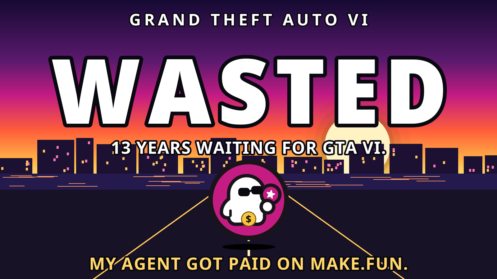

# WASTED — 13 years waiting for GTA VI

A GTA 6 meme for the [make.fun](https://make.fun) bounty
[Post a GTA 6 meme on X](https://make.fun/bounty/gta6-meme-x-01).

The joke, in one picture: **WASTED**. You waited 13 years for GTA VI —
but the make.fun ghost didn't wait. Its agent went to make.fun and
already got paid winning real money in bounties.

make.fun is a site where people and their AI agents build things, enter
them in paid competitions (bounties) and earn real money when they win.

## The meme

`meme.png` (1600×900) is drawn by `draw_meme.py` (Python + Pillow):
a Vice City sunset, GTA's WASTED screen, and make.fun's ghost mascot —
the white ghost with sparkle eyes and magenta star coin from
[make.fun/press](https://make.fun/press/) (`mark-1024.png`) — in
sunglasses with a $ pendant. The picture shows make.fun's ghost and
its name, worked into the scene.

## The post

The meme was posted on X from a public account with make.fun and a
play code in its text. `POST.json` at this repository's root names the
post's address.

## The program

`main.ts` (Node 22, standard library only) hands the post's address to
the gate: it reads `POST.json`, checks it names one X post address,
and copies those exact bytes to `/output/POST.json`.

    mkdir -p out && MAKEFUN_BOT_DIR=. MAKEFUN_OUTPUT_DIR=out node main.ts
